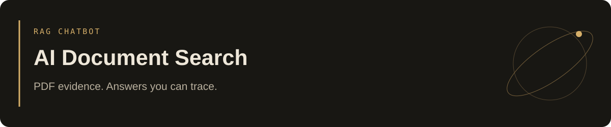

# AI Document Search (RAG Chatbot)



Chat with a PDF library and inspect the evidence behind each answer. Page-aware ingestion, semantic retrieval, and numbered citations connect the conversation to its original sources.

**React · Tailwind · Python / FastAPI · LangChain · OpenAI · FAISS**


*Actual local application. This welcome view does not represent a benchmark result.*

## Verified results

| Check | Observed result |
| --- | --- |
| Automated validation | **16 tests passed**, with deterministic provider doubles |
| Live PDF-to-answer check | Correct **$4,800** pilot budget, with a supporting passage on **page 2** |
| Packaging | TypeScript/build checks and Docker smoke checks passed |

[Validation record](VALIDATION.md). The live check used a fictional Atlas PDF; it demonstrates integration, not general answer accuracy. The guided preview is explicitly prepared content.

## Run locally

Requires **Python 3.12+**, **Node.js 22+**, and **pnpm 11.25.0**. Live indexing and chat require an OpenAI API key with API credit.

```sh
git clone https://github.com/Abhinav-tanwar/AI-Document-Search-RAG-Chatbot.git
cd AI-Document-Search-RAG-Chatbot
python3.12 -m venv .venv
.venv/bin/python -m pip install -r backend/requirements.txt
corepack enable
corepack prepare pnpm@11.25.0 --activate
cd frontend
pnpm install --frozen-lockfile
cd ..
cp .env.example .env
```

Add `OPENAI_API_KEY` to `.env` in your local editor, then:

```sh
.venv/bin/python run.py
```

Open **http://127.0.0.1:5180**; API docs: **http://127.0.0.1:8010/docs**. Try the key-free guided preview, or upload a text-based PDF and ask a question. Open a citation to inspect the original page. Ctrl+C stops both services.

## How it works

`PDF → page-aware chunks → OpenAI embeddings → SQLite + FAISS → retrieved passages → cited answer`

- Scope retrieval to selected documents and inspect source passages.
- Persist the library across restarts; deduplicate identical uploads and index atomically.
- Delete a document together with its searchable passages.

## Verify

```sh
.venv/bin/python -m pip install -r backend/requirements-dev.txt
.venv/bin/python -m pytest -q
cd frontend
pnpm build
```

## Scope and data

Local, single-user application; authentication and tenant isolation are not included. PDF text goes to OpenAI for embeddings and relevant passages go to the chat model. Scanned PDFs need OCR, which is not implemented. Citations enable inspection but do not prove every generated claim. Keep `.env` and runtime data out of Git.

[Architecture, configuration, Docker, Vercel and API guide](docs/guide.md)

<sub>macOS/Linux commands shown. On Windows, use `py -3.12 -m venv .venv` and replace `.venv/bin/python` with `.venv\Scripts\python.exe`.</sub>
