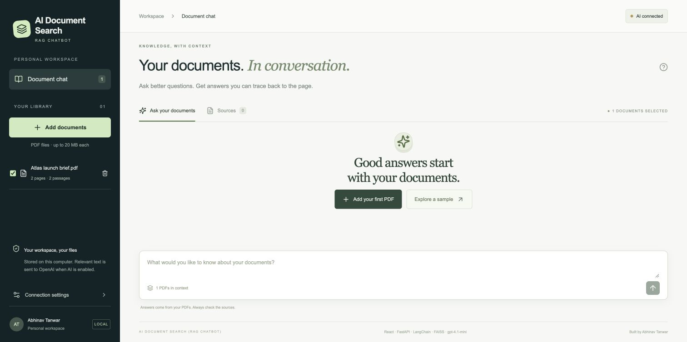
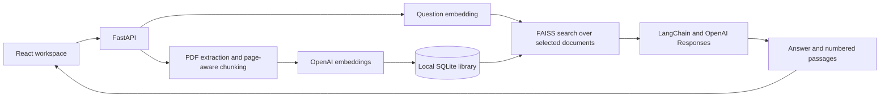

# AI Document Search (RAG Chatbot)

[](https://github.com/Abhinav-tanwar/AI-Document-Search-RAG-Chatbot/actions/workflows/check.yml)

A document research application that turns PDF libraries into searchable conversations. Answers are grounded in retrieved passages, with document names, page numbers, and access to the original source.

**Built by [Abhinav Tanwar](https://github.com/Abhinav-tanwar).**



## Features

- **Semantic PDF search:** OpenAI embeddings and FAISS retrieve passages by meaning.
- **Grounded conversations:** LangChain passes selected evidence to an OpenAI model with instructions to cite sources and acknowledge missing information.
- **Page-level traceability:** Inspect extracted passages and open the original PDF at the referenced page.
- **Document controls:** Upload multiple PDFs, select the documents included in a question, and delete documents from the local library.
- **Persistent library:** SQLite stores original PDFs, extracted text, metadata, and normalized vectors across restarts.
- **Atomic indexing:** A failed embedding request leaves no partially indexed document. Identical uploads are deduplicated using SHA-256.
- **Key-free guided preview:** A fictional two-page brief and explicitly labeled prepared answer demonstrate the interface without API calls.
- **Local development and containers:** A combined launcher starts the frontend and backend; Docker serves the production build. Vercel configuration is provided for the frontend.

## Technology

| Layer | Implementation |
| --- | --- |
| Frontend | React, TypeScript, Tailwind CSS, Vite |
| Backend | Python, FastAPI, Pydantic |
| AI orchestration | LangChain |
| Language model | OpenAI Responses API; configurable model |
| Embeddings | OpenAI `text-embedding-3-small` by default |
| Vector search | FAISS cosine similarity through normalized inner products |
| Persistence | SQLite |
| Packaging | Docker Compose; Vercel frontend configuration |
| Verification | pytest, TypeScript, production build, GitHub Actions |

## Architecture



PDF text is split **within individual pages** into 1,400-character passages with 180-character overlap. Search retrieves up to five passages from the selected documents. Recent user questions provide context for follow-up retrieval; previous model answers are never treated as evidence.

FAISS indexes are rebuilt in memory from persisted vectors for each query. This keeps storage straightforward and document deletion consistent for a personal library; larger deployments would benefit from a long-lived index or a dedicated vector service.

## Run locally

Requirements: **Python 3.12+**, **Node.js 22+**, **pnpm 11.25.0**, and an OpenAI API account with available credit for live indexing and chat.

```sh
git clone https://github.com/Abhinav-tanwar/AI-Document-Search-RAG-Chatbot.git
cd AI-Document-Search-RAG-Chatbot
python3 -m venv .venv
.venv/bin/python -m pip install -r backend/requirements.txt
corepack enable
corepack prepare pnpm@11.25.0 --activate
cd frontend
pnpm install --frozen-lockfile
cd ..
cp .env.example .env
```

Set `OPENAI_API_KEY` privately in `.env`, then start both services:

```sh
.venv/bin/python run.py
```

The workspace is available at **http://127.0.0.1:5180** and the API documentation at **http://127.0.0.1:8010/docs**. Ctrl+C stops both services. The macOS shortcut is **Start AI Document Search.command**. On Windows, replace `.venv/bin/python` with `.venv\Scripts\python.exe`.

The guided preview runs without an API key. Live document indexing and custom questions require one. API billing is separate from ChatGPT subscriptions.

### Configuration

| Variable | Purpose |
| --- | --- |
| `OPENAI_API_KEY` | Backend-only OpenAI credential |
| `OPENAI_CHAT_MODEL` | Chat model; default `gpt-4.1-mini` |
| `OPENAI_EMBEDDING_MODEL` | Embedding model; default `text-embedding-3-small` |
| `DATA_DIR` | Optional private storage directory; defaults to `data/` |
| `CORS_ORIGINS` | Explicit permitted browser origins |
| `VITE_API_BASE_URL` | Optional remote backend URL, set before the frontend build |

Restart the backend after changing `.env`. Changing the embedding model requires a new data directory and reindexing, because embeddings from different models are not interchangeable. The connection badge detects the presence of a key; the first successful API request validates access.

## Verification

```sh
.venv/bin/python -m pip install -r backend/requirements-dev.txt
.venv/bin/python -m pytest -q
cd frontend
pnpm build
```

**16 automated tests** cover page attribution, persisted retrieval, document scoping, duplicate handling, invalid PDFs, atomic indexing failures, deletion, missing credentials, untrusted browser origins, prompt boundaries, citation-number validation, and the LangChain Responses API wire contract. Automated tests use deterministic test doubles and do not incur API charges.

A separate live integration check indexed the fictional Atlas brief and answered “What is the pilot budget?” with **$4,800**, supported by **page 2**. The Docker image was built and smoke-tested for the frontend, health endpoint, sample response, and PDF delivery. See [validation details](../VALIDATION.md).

## Docker

With a configured `.env` file:

```sh
docker compose up --build
```

Open **http://127.0.0.1:8010**. FastAPI serves the production React build from a single container. The container runs as a non-root user, binds to loopback on the host, and stores the library in a named volume. `docker compose down` stops the application while retaining that volume.

The internal `folio` service and volume identifiers are retained for compatibility with existing local containers and stored libraries.

### Vercel frontend

Set the Vercel project root to `frontend`. Its `vercel.json` defines the Vite build and output directory. Set `VITE_API_BASE_URL` to an independently hosted HTTPS Docker backend before building and set the backend's `CORS_ORIGINS` to the exact frontend origin. Keep the OpenAI key exclusively on the backend.

Vercel hosts the frontend only; the persistent document library belongs to the Docker backend. Public deployment requires authentication and access controls before exposing the API. No hosted deployment is included in this repository.

## Data handling and limitations

- Uploaded PDFs and their searchable text remain in local application storage. Extracted text is sent to OpenAI for embeddings; questions and retrieved passages are sent for answers. Requests use `store=False` for Responses API generation. This is not a claim of zero provider retention.
- `.env`, runtime data, Python environments, and frontend dependencies are excluded from Git. API credentials never belong in frontend environment variables. Application code does not intentionally log document contents or prompts; LangSmith tracing is disabled by default.
- Deletion removes the application's document record, original PDF, and passages, and clears the visible conversation. It does not guarantee forensic disk erasure or retract data already processed by the provider.
- Limits are 20 MB, 300 pages, and 1,500 passages per PDF. Encrypted, invalid, and textless PDFs receive actionable errors. OCR is not implemented.
- Documents are untrusted evidence. The model has no execution tools or filesystem access. Prompt instructions and source-number validation reduce risk but do not eliminate prompt injection or hallucination.
- Citations identify retrieved passages; they do not automatically establish that every generated claim is supported. Review source pages for important conclusions.
- This is a local, single-user application without authentication or multi-user isolation. Chat history stays in the browser tab's memory; the document library persists on disk.

## API reference

| Endpoint | Purpose |
| --- | --- |
| `GET /api/health` | Service and key-configuration readiness |
| `GET /api/documents` | Library metadata |
| `POST /api/documents` | Multipart PDF upload and indexing |
| `DELETE /api/documents/{id}` | Remove a document and its passages |
| `GET /api/documents/{id}/pdf` | Original PDF |
| `POST /api/chat` | Question, selected document IDs, and recent history |
| `GET /api/demo` | Prepared fictional walkthrough |
| `GET /api/demo/pdf` | Fictional source PDF |

## Project structure

```text
backend/app/       FastAPI routes, PDF ingestion, persistence, and retrieval
backend/tests/     Retrieval, API, and provider-contract tests
frontend/src/      React workspace, conversation UI, and source explorer
sample/            Fictional Atlas PDF for reproducible demonstrations
screenshots/       Application previews
run.py             Local frontend/backend process launcher
Dockerfile         Production frontend build and Python runtime
compose.yaml       Local container and persistent storage
```

## References

- [OpenAI Responses API](https://developers.openai.com/api/reference/python/resources/responses/methods/create)
- [LangChain](https://docs.langchain.com/)
- [FAISS](https://github.com/facebookresearch/faiss)
